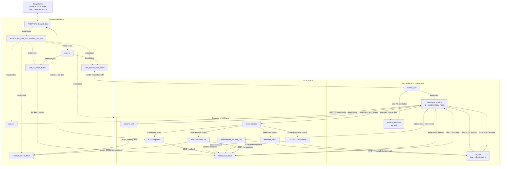

# RV32IM-Style FPGA SoC with MATVEC Accelerators

[](https://github.com/Kevinchen1104/rv32im-basys3-soc/actions/workflows/check.yml)
[](https://github.com/Kevinchen1104/rv32im-basys3-soc/actions/workflows/release-consistency.yml)

This repository implements a five-stage RV32IM-style processor and a small
FPGA-oriented SoC in synthesizable Verilog. The default system includes
instruction and data caches, branch prediction, machine-mode trap support,
UART, GPIO, a machine timer, performance counters, and two signed-int8 matrix
vector paths:

- **MATVEC Scratchpad:** software stages one vector and up to 16 rows through
  the `0x0700..0x0720` MMIO window. Completion can raise the machine external
  interrupt.
- **MATVEC DMA-lite:** software supplies DMEM addresses for one vector, one to
  four rows, and results through the `0x0900..0x091c` MMIO window. It is
  polling-only and deliberately not cache coherent.

The `0x0400..0x05ff` range is not MMIO and follows ordinary memory behavior.

## Architecture

Conceptual hierarchy and data-flow overview; some boxes group internal logic
and are not one-to-one RTL modules. Dashed arrows show instantiation/grouping;
solid labeled arrows show the principal data or control paths.



## Verification snapshot

| Evidence | Recorded result |
| --- | --- |
| Portable regression | **163 / 163 passed** |
| Bounded formal | **8 focused harnesses**; scopes listed in [`formal/README.md`](formal/README.md) |
| Canonical FPGA target | `RISCVCPU_basys3_top`, **100 MHz** on `xc7a35tcpg236-1` |
| Current implementation | Commit `d7f1afe`: **timing met**, WNS `+0.318 ns`, TNS `0` |
| Current utilization | 12,578 LUT, 7,148 FF, 2 BRAM, 0 DSP |
| Strategy sweep | **5 / 5 timing met**; worst WNS `+0.079 ns`, optional `+0.200 ns` margin target not met |
| Current physical validation | 2026-07-30: scoped XSDB/UART/LED/reset pass |

The Check badge runs the portable `scripts/check.ps1` gate. Verilator, Yosys,
bounded formal, Vivado, physical validation, and final release audit are
separate recorded gates. The package in [`release/final/`](release/final/)
records the corresponding source identity, tool evidence, physical scope, and
explicit non-claims. The Release consistency badge checks that committed
package from a clean clone; it validates identities and hashes but does not
rerun Vivado or hardware.

## Repository map

| Path | Purpose |
| --- | --- |
| `rtl/` | CPU, memories, peripherals, accelerators, and FPGA tops |
| `firmware/` | Assembly programs and deterministic hex images |
| `tb/` | Directed unit, integration, program, assertion, and reference tests |
| `formal/` | Bounded formal smoke harnesses |
| `fpga/` | Board profiles, constraints, and Vivado flow |
| `scripts/` | Portable checks, regressions, audits, synthesis, and release tools |
| `docs/` | Architecture, interfaces, verification, reproduction, and limits |
| `release/` | Generated evidence packages; useful for review, not the source of truth |

## Quick start

Requirements for the portable flow are PowerShell, Icarus Verilog, and Git.
Yosys, Verilator, SymbiYosys, and Vivado enable additional checks.

```powershell
powershell -ExecutionPolicy Bypass -File scripts/assemble.ps1 -Check
powershell -ExecutionPolicy Bypass -File scripts/run.ps1 -Test mmio_decode -SkipAssemble
powershell -ExecutionPolicy Bypass -File scripts/run.ps1 -Test program_matvec_scratchpad -SkipAssemble
powershell -ExecutionPolicy Bypass -File scripts/run.ps1 -Test program_matvec_dma_demo -SkipAssemble
powershell -ExecutionPolicy Bypass -File scripts/check.ps1
```

The full regression manifest and evidence boundaries are in
[`docs/test_catalog.json`](docs/test_catalog.json). Optional local gates:

```powershell
powershell -ExecutionPolicy Bypass -File scripts/verilator-lint.ps1
powershell -ExecutionPolicy Bypass -File scripts/synth-smoke.ps1
powershell -ExecutionPolicy Bypass -File scripts/formal-smoke.ps1
powershell -ExecutionPolicy Bypass -File scripts/formal-matvec-smoke.ps1
```

## Basys3

`RISCVCPU_basys3_top` is the canonical direct-100-MHz target. The repository
keeps alternate bring-up profiles in the
[Basys3 board documentation](fpga/boards/basys3/README.md), but public results
on this page refer to the canonical target. Timing is claimed only from
matching post-route reports with `WNS >= 0` and `TNS = 0`. The current
canonical build at commit `d7f1afe` met timing with WNS `+0.318 ns`, TNS
`0 ns`, WHS `+0.027 ns`, and THS `0 ns`, then passed the scoped
XSDB/UART/LED/reset suite. Five documented implementation-directive profiles
also met timing; their worst WNS was `+0.079 ns`, so the optional `+0.200 ns`
margin target was not met and random-seed robustness is not claimed.
The [2026-07-30 evidence](docs/fpga/board_evidence/basys3_full_direct_100mhz_2026-07-30/README.md)
records the source identity, exact captures, observations, and boundaries.

Start with [`docs/README.md`](docs/README.md). The main non-claims are summarized
in [`docs/limitations.md`](docs/limitations.md).
