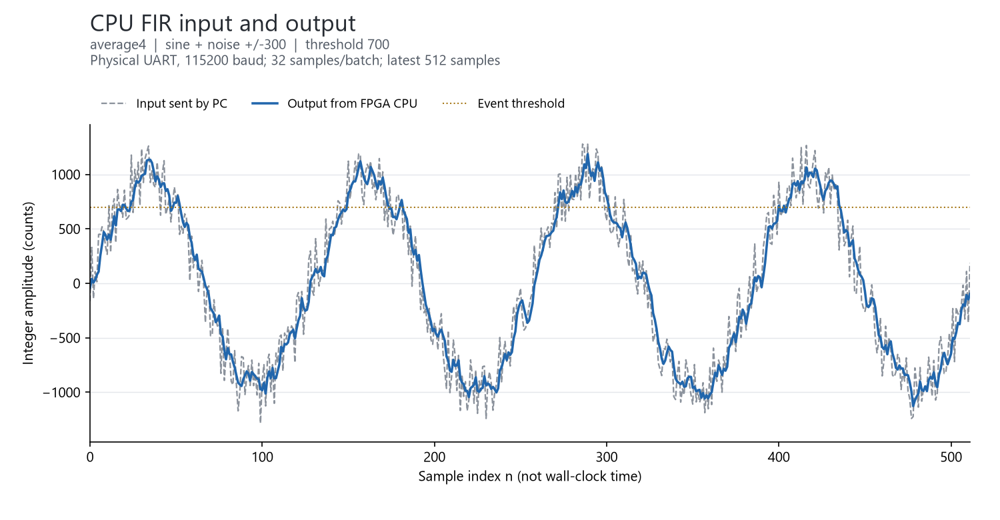
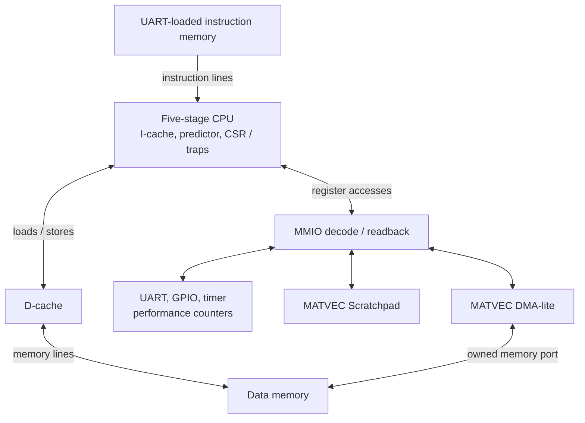

# RV32IM-Style FPGA SoC and Interactive Signal Processing

[](https://github.com/Kevinchen1104/rv32im-basys3-soc/actions/workflows/check.yml)
[](https://github.com/Kevinchen1104/rv32im-basys3-soc/actions/workflows/release-consistency.yml)

This is a five-stage processor and FPGA SoC that runs GCC-compiled C firmware
on a Basys3. Its interactive application filters a stream of samples, keeps
history between requests, counts threshold events, reads switches and drives LEDs.
Changing the filter or input data does not require rebuilding the FPGA.

The project investigates how multiplier latency, cache organization and
accelerator overhead affect useful work. The application gives the SoC a
usable workload; same-binary architecture experiments explain its trade-offs.

## Try the signal application

The PC generates a noisy sine or step signal. The physical CPU computes every
returned FIR output; Python displays it rather than substituting its own filter.
Pause/resume, choose averaging or difference presets, and save the latest 512
samples as CSV/PNG with source-identified metadata.



This is a host-paced UART stream, not a fixed-rate ADC acquisition. Both traces
use integer counts and the same sample index; the filter delay is not removed.
The [capture and independent output checks](docs/fpga/board_evidence/automatic_acceptance_5c1c4c0/README.md)
record the settings, data and reproduction command.

After the [one-time firmware and FPGA setup](docs/signal-console.md#build-and-test):

```powershell
.venv/Scripts/python.exe -B scripts/signal_start.py --list-ports
.venv/Scripts/python.exe -B scripts/signal_start.py --port COM3
```

Replace `COM3` with your board's port. After **BTN C**, add `--upload`. After
power loss, explicitly load the application bitstream with `--program` (XSDB)
or Vivado Hardware Manager, then upload the firmware. The
[startup guide](docs/signal-console.md#startup-and-recovery) explains these states
and includes a non-mutating local preflight. Reprogramming requires the explicit
`--program` option.

No board available? Run the [portable simulation checks](#quick-start), or the
[C firmware UART simulations](docs/signal-console.md#build-and-test).
For a short live presentation, follow the
[five-minute walkthrough](docs/signal-console.md#five-minute-walkthrough):
show programmable behavior first, then discuss the three decisions below.

## Three architecture decisions

These questions connect the working application to controlled experiments.
The cycle comparisons below are RTL measurements; routed FPGA cost/timing and
physical UART observations are identified separately in each study.

1. **How much instruction cache is enough?** The same `-O2` CRC-32 image takes
   12,321 cycles with 64 B, 8,377 with 256 B, and 8,371 with 1 KiB. The hot loop
   spans 16 cache lines: 256 B captures almost all the benefit, while 1 KiB saves
   only six more cycles. Both banked candidates meet the routed 100 MHz target;
   the 256 B SoC uses 6,905 LUTs versus 6,967 for 1 KiB. The decision is to size
   for the measured working set, not maximize capacity. The
   [80-run I-cache study](docs/icache-study.md) also shows load-dominated cases
   with no cycle benefit. The 256 B candidate has simulation and routed evidence,
   not a physical-board measurement; the default remains 64 B.
2. **Do fewer memory transfers mean proportionally faster code?** Adding four
   victim lines to the 64 B primary cache reduces the same `-O2` FIR image's
   completed 16-byte transfers (fills + writebacks) from 519 to 57
   (**89.02% fewer**), but cycles only fall from 11,301 to 9,950
   (**11.95% fewer**). Arithmetic and other stalls remain,
   and a victim lookup adds cost on a backing-memory miss. Sequential traversal
   becomes **3.27% slower**. At equal 128 B data capacity, the physical FIR
   application favors direct mapping while the `-O2` FIR C benchmark favors
   four victims.
   The decision is workload-dependent; neither organization always wins.
   The [300-run D-cache study](docs/dcache-study.md) compares traffic, cycles,
   whole-SoC resources, six routed configurations and physical FIR captures.
3. **When does an accelerator repay its driver and transfer cost?** With
   synchronous BRAM, a streaming 16-row, eight-job MATVEC workload takes 8,310
   cycles on the fast CPU versus 2,136 with DMA, a **3.89x cycle speedup** including
   driver work. One row and one job tie at 143 cycles; with a reused matrix,
   Scratchpad can beat DMA. The decision is to compare end-to-end work against
   a strong CPU baseline, then account for reuse and hardware cost. DMA adds
   1,535 whole-SoC LUTs over that fast CPU, not just the 674 LUTs in the DMA
   module. The [380-run architecture study](docs/architecture-evaluation.md)
   separates internal RAM from synchronous BRAM and records the complete matrix.

The live application's UART round-trip time is a different metric: its
[burst-transfer measurement](docs/signal-console.md) shows that communication
can dominate the CPU's FIR processing time. These are different workloads and
measurement intervals; compare speedups within each study. The
[90-case MATVEC benchmark](docs/matvec-benchmark.md), routed implementation
measurements and dated physical captures remain independently traceable.

## Architecture

The shared system contains instruction/data caches, branch prediction,
machine-mode traps, UART, GPIO, a timer and performance counters. The
default profile adds two signed-int8 MATVEC interfaces: a software-filled
Scratchpad with optional completion interrupt, and a polling DMA-lite path
that owns the data-memory port during a job and snoops the local D-cache.

| Profile | Multiplier | MATVEC blocks | Purpose |
| --- | --- | --- | --- |
| Default SoC | Iterative | Scratchpad and DMA-lite | Offload and system experiments |
| `fast_cpu` FIR application | DSP-assisted | None | Interactive software filtering at 100 MHz |

The overview groups related blocks by function. Arrows show data paths; see
[Architecture](docs/architecture.md) for pipeline control and UART boot, and
[Accelerators](docs/accelerators.md) for the two MATVEC data flows.



The diagram shows the default SoC; the FIR application omits the two MATVEC
blocks. The board wrapper connects the SoC to the Basys3 100 MHz clock,
synchronized reset/switch inputs, LEDs and UART pins. See the
[operating constraints](docs/limitations.md) for the implemented ISA subset,
memory limits and accelerator contracts.

## Verification snapshot

| Evidence | Recorded result |
| --- | --- |
| Portable regression | **169 / 169 passed** |
| Python tools and viewer | **110 / 110 passed**, including Tk controls |
| Official Sail cross-check | **36 selected upstream RV32I/M tests**, 552,404 signature words matched; [scope and reproduction](docs/compiled-programs.md#optional-upstream-sail-comparison) |
| Physical viewer output checks | Source-matched repeat at `5c1c4c0`: **10 sessions, 8,704 outputs passed**; [capture and reproduction](docs/fpga/board_evidence/automatic_acceptance_5c1c4c0/README.md) |
| Bounded formal | **8 focused harnesses**; scopes listed in [`formal/README.md`](formal/README.md) |
| Canonical FPGA target | `RISCVCPU_basys3_top`, **100 MHz** on `xc7a35tcpg236-1` |
| Routed implementation | Default profile, build `9d46f04`, 100 MHz: **timing met**, WNS `+0.323 ns`, TNS `0`; hold and DRC pass |
| Routed utilization | Default profile: 9,476 LUT, 7,179 FF, 2 BRAM, 0 DSP |
| FIR application implementation | Separate `fast_cpu` image, build `5c1c4c0`: 6,718 LUT, 5,287 FF, 2 BRAM, 4 DSP; 100 MHz WNS `+0.067 ns`, WHS `+0.010 ns`; [reports](docs/fpga/board_evidence/automatic_acceptance_5c1c4c0/application-reports/) |
| Banked 1 KiB I-cache, current 64 B direct D-cache | `fast_cpu`: 6,967 LUT, 4,741 FF, 2 BRAM, 4 DSP; 100 MHz WNS `+0.116 ns`, WHS `+0.039 ns`; [six-profile comparison](docs/dcache-study.md#complete-six-profile-comparison) |
| Four-line victim-cache implementation | With 1 KiB I-cache: 7,804 LUT, 5,388 FF, 2 BRAM, 4 DSP; 100 MHz WNS `+0.306 ns`, WHS `+0.036 ns`; [source-matched reports](docs/benchmarks/dcache/capacity/implementation/victim4/) |
| Physical validation | Default build `9d46f04`, inputs matched to `5c1c4c0`: JTAG/UART/RV32M/timer/DMA checks passed; 90 MATVEC cases / 2,418 outputs passed twice, including after JTAG reload |

The cache studies include physical FIR comparisons as well as simulation
and routed implementation. The automatic acceptance programs the `9d46f04`
default image and the rebuilt `5c1c4c0` application image; all 45 hardware/build
inputs matched the source reviewed for that record. The six cache comparisons
identify each candidate separately. The 128 B direct and four-victim candidates were also
reloaded and repeated, reproducing all 200 stress-batch cycle counts.
The board configuration defaults remain unchanged. JTAG reload is not an
operator-pressed BTN C test; earlier manual observations retain their dated records.

The Check badge runs the portable `scripts/check.ps1` workflow and a separate
Python client/tool test job, including Tk controls. The manually dispatched
extended workflow also runs GCC/Unicorn comparisons and FIR UART simulation. Optional
Verilator, Yosys, formal, and Vivado runs are documented in
[Verification](docs/verification.md). The current
[timing and resource comparison](docs/timing_baseline.md) records the shared
shifter, banked IMEM, frontend/cache-path changes, return hints, MATVEC byte
writes, and a clock-period sweep. The earlier `e96f878` RTL met a 9.5-ns
(105.26-MHz) implementation target; its 9.0-ns run failed setup timing.
The board profile remains 100 MHz. The
[dated automatic board record](docs/fpga/board_evidence/automatic_acceptance_5c1c4c0/README.md)
contains source-matched bitstream identities, UART captures, numerical checks
and measured cycle counts. Manual LED/reset observations remain in the
[2026-09-30 record](docs/fpga/board_evidence/basys3_full_direct_100mhz_2026-09-30/README.md).
The earlier five-strategy timing sweep and board observations remain in
the [2026-07-30 record](docs/fpga/board_evidence/basys3_full_direct_100mhz_2026-07-30/README.md).
The Evidence integrity badge checks the recorded identities and hashes in the
committed [review snapshots](release/README.md), and reports whether their inputs
match the checkout. The Check job runs the current source.
Recorded development revisions are preserved when publishing an integrated
update. The later documentation/header corrections change source-file hashes,
not RTL logic; saved measurements retain their original inputs and dates.
See [public history and evidence identity](docs/evidence/README.md#public-history-and-recorded-revisions).

## Repository map

| Path | Purpose |
| --- | --- |
| `rtl/` | CPU, memories, peripherals, accelerators, and FPGA tops |
| `firmware/` | Assembly programs, deterministic hex images, and freestanding C examples |
| `tb/` | Directed unit, integration, program, assertion, and reference tests |
| `formal/` | Bounded formal smoke harnesses |
| `fpga/` | Board profiles, constraints, and Vivado flow |
| `scripts/` | Portable checks, regressions, audits, synthesis, and release tools |
| `docs/` | Architecture, interfaces, verification, reproduction, and limits |
| `release/` | Source-identified verification snapshots, implementation reports, and historical evidence |
| `build/` | Rebuildable executables, tool workspaces, and temporary test inputs (ignored by Git) |
| `results/` | Result index, JSON/CSV summaries, and input-isolated logs/VCDs under `runs/` (ignored by Git) |

## Quick start

Requirements for the portable flow are Windows PowerShell 5.1, Icarus Verilog, and Git.
Yosys, Verilator, SymbiYosys, and Vivado enable additional checks.
The optional [compiled C flow](docs/compiled-programs.md) uses RISC-V GCC and
Unicorn to compare twelve compiler-generated executions with the RTL.

Clone with Git so verification can record the source revision and input hashes.
Use a short checkout path on Windows, such as `C:\src\rv32im-basys3-soc`.
The Full self-tests create nested fixtures and result paths; a deeply nested
checkout can exceed Windows PowerShell 5.1's path-length limit when writing logs.

```powershell
git clone https://github.com/Kevinchen1104/rv32im-basys3-soc.git
cd rv32im-basys3-soc
```

Run from the repository root. Choose the level that matches the task:

| Level | When to use it | Entry point |
| --- | --- | --- |
| Quick | After an everyday edit | `scripts/check.ps1 -Mode Quick` |
| Full | Before keeping a change or updating evidence | `scripts/check.ps1 -Mode Full` |
| Python tools | After changing clients, plots or experiment helpers | `scripts/python_tests.py --gui` |
| Release / FPGA | When preparing a hardware or public release | [Reproduction guide](docs/reproduce.md#release--fpga) |

```powershell
powershell -ExecutionPolicy Bypass -File scripts/check.ps1 -Mode Quick
```

Quick checks firmware freshness, RTL hygiene, catalog consistency, and six
representative simulations: basic CPU, RV32M, pipeline invariants, MMIO decode,
Scratchpad firmware, and DMA-lite firmware. Open `results/quick-RESULTS.md`.

For the complete gate, run:

```powershell
powershell -ExecutionPolicy Bypass -File scripts/check.ps1 -Mode Full
```

Full retains all 169 simulations, reference and helper checks, and eight FPGA
top elaborations. Open `results/RESULTS.md` for the project overview,
`results/full-RESULTS.md` for workflow stages, and `results/regression.csv`
for individual tests. Omitting `-Mode` also runs Full. Quick, Full, and
different test arguments keep separate logs and waveforms under `results/runs/`.
Repeating the same context replaces that context's results. The overview marks
results whose recorded inputs no longer match the working source.

Python checks are separate so the portable RTL flow does not acquire plotting
or emulator dependencies. Use native Windows Python 3.11 or later with Tk
(CI uses 3.12). Create `.venv` once with `py -3 -m venv .venv`, or reuse your
existing native Windows environment. Install both Python requirement files and run:

```powershell
.venv/Scripts/python.exe -m pip install -r scripts/signal-viewer-requirements.txt -r tools/compiled-programs/requirements.txt
.venv/Scripts/python.exe -B scripts/python_tests.py --gui
powershell -ExecutionPolicy Bypass -File scripts/results-overview.ps1
```

Read `results/python-tests/summary.json` and `tests.log`. Without `--gui`, the
Tk-control test is explicitly skipped and counted; missing plotting/emulator
dependencies fail the runner instead of silently reducing coverage. No board is
needed. Environment setup is in [Compiled C programs](docs/compiled-programs.md).

For planning, a measured local run took about 34 seconds for Quick,
11 minutes 16 seconds for Full, and 29-39 seconds for the Python tests.
These exclude installing dependencies; CPU speed, antivirus scanning and
disk performance affect the times. Vivado implementation and physical-board
checks are separate from these commands.

Compiled simulators can occupy hundreds of MiB locally. The
[disk cleanup guide](docs/reproduce.md#disk-usage-and-cleanup) provides a
preview-first command that removes rebuildable `.vvp` files and keeps results.

To rerun a single test:

```powershell
powershell -ExecutionPolicy Bypass -File scripts/run.ps1 -Test program_matvec_scratchpad
```

The catalog in [`docs/test_catalog.json`](docs/test_catalog.json) retains each
test's contract and coverage metadata; shared values are declared once in
`defaults`, with per-test overrides. Optional local gates:

```powershell
powershell -ExecutionPolicy Bypass -File scripts/verilator-lint.ps1
powershell -ExecutionPolicy Bypass -File scripts/synth-smoke.ps1
powershell -ExecutionPolicy Bypass -File scripts/formal-smoke.ps1
powershell -ExecutionPolicy Bypass -File scripts/formal-smoke.ps1 -Group Matvec
```

## Basys3

`RISCVCPU_basys3_top` is the direct-100-MHz target. The
[Basys3 guide](fpga/boards/basys3/README.md) covers implementation, board
programming, and alternate bring-up profiles.

For further reading, use the [documentation index](docs/README.md), including
the [supported configuration and operating constraints](docs/limitations.md).
