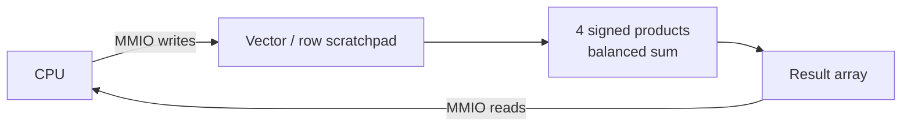
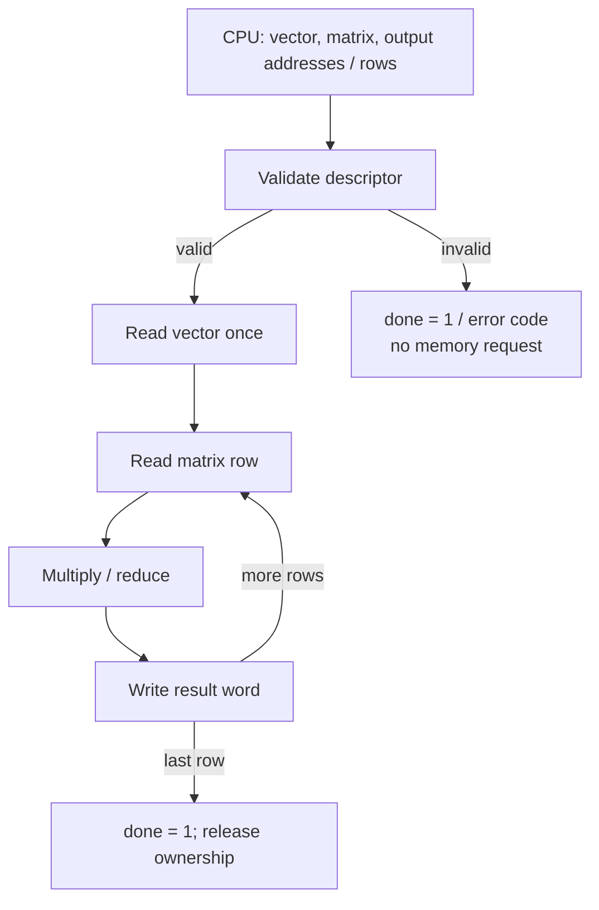

# Accelerators

Both accelerators compute signed-int8 dot products with four lanes per row and
return signed 32-bit results. They expose different software/data-movement
contracts and do not share a start register.

The [end-to-end benchmark](matvec-benchmark.md) compares both interfaces with
GCC-compiled software, including data movement and polling.

## MATVEC Scratchpad

RTL module: `int8_matvec_scratchpad_accelerator`

Software loads the operands before starting and reads results after `done`.
The engine processes rows sequentially; each row computes four products.

| Address | Register | Behavior |
| --- | --- | --- |
| `0x0700` | CTRL | bit 0 start, bit 1 clear done/flags, bit 2 enable interrupt, bit 3 disable interrupt, bit 4 clear IRQ |
| `0x0704` | STATUS | bit 0 busy, bit 1 done, bit 2 ignored start, bit 3 ignored busy write, bits 7:4 active row, bit 8 IRQ pending, bit 9 interrupt enable |
| `0x0708` | CONFIG | bits 3:0 `row_count_minus1` (`0..15` means 1..16 rows) |
| `0x070c` | VECTOR | four packed signed-int8 lanes |
| `0x0710` | ROW_INDEX | selected scratchpad row (`0..15`) |
| `0x0714` | ROW_DATA | selected packed row |
| `0x0718` | RESULT_INDEX | selected result (`0..15`) |
| `0x071c` | RESULT_DATA | selected signed 32-bit result |
| `0x0720` | PERF | bytes: completed operations, ignored starts, ignored busy writes |

An idle start snapshots the vector and row count. Each row advances through
load, multiply, balanced reduction, and commit stages. Configuration, operand,
and index writes while busy are ignored and counted. A start while busy is
ignored and counted. `done` is sticky until cleared. When interrupt enable is
set, completion raises the machine external-interrupt pending source.
On a final commit edge, completion wins over simultaneous done/IRQ clears.
IRQ generation samples the interrupt-enable value from before that edge, so an
enable write at final commit affects the next job while a disable write does
not cancel the completion IRQ already being accepted.

For consecutive polling jobs, write `CTRL=3` while idle to clear the previous
`done` flag and start the next job in one write. Polling a new job without
clearing the sticky flag can return before its results are ready.

## MATVEC DMA-lite

RTL module: `int8_matvec_dma_lite`

Descriptors select memory operands instead of copying them into MMIO operand
registers. The CPU polls status while the engine transfers and computes.

| Address | Register | Behavior |
| --- | --- | --- |
| `0x0900` | VECTOR_ADDR | Word-aligned DMEM address of one packed vector |
| `0x0904` | MATRIX_ADDR | Word-aligned address of consecutive packed rows |
| `0x0908` | OUT_ADDR | Word-aligned address for consecutive 32-bit results |
| `0x090c` | ROWS | Valid range `1..4` |
| `0x0910` | CTRL | bit 0 start, bit 2 clear done/error |
| `0x0914` | STATUS | bit 0 busy, bit 1 done, bit 2 error, bits 5:4 active row |
| `0x0918` | ERROR | bits 0..5 rows/alignment/busy errors; bits 6..8 vector/matrix/output range errors; bit 9 matrix/output overlap |
| `0x091c` | PERF | bytes: jobs started, jobs completed, DMEM reads, DMEM writes |

Invalid descriptors finish with `done=1` and a stable error code. `ROWS` keeps
the full 32-bit software value, so values outside `1..4` cannot become valid by
truncation. Validation uses 33-bit end-address arithmetic for every vector,
matrix row, and output word; descriptors that exceed `MEMORY_WORD_COUNT` or
wrap the 32-bit address space are rejected before any DMEM request is issued.
The matrix and output ranges must be disjoint because each result is written
before the next matrix row is read; overlapping descriptors are rejected.
Configuration writes while busy are rejected. DMA-lite is polling-only:
`irq_pending` is tied low.

### Software sequence and cache behavior

Use this sequence, illustrated by the
[DMA demo](../firmware/src/accelerator/matvec_dma_demo.S):

1. Store the packed vector and matrix rows in ordinary DMEM.
2. Set the three word-aligned base addresses and a row count from 1 to 4.
   Keep the matrix and output ranges disjoint and within memory capacity.
3. Write `CTRL.start`, then poll `STATUS.error` and `STATUS.done`.
   If an error is set, read `ERROR` before consuming results.
4. After successful completion, load the output words through the CPU's
   ordinary memory path. Write `CTRL` bit 2 to clear done/error when needed.

During a job, `matvec_dma_cpu_memory_stall` holds CPU non-MMIO loads/stores;
MMIO status polling remains available. A DMA read checks the D-cache snoop
port and uses the cached word on a hit, including a dirty CPU-written value.
An accepted DMA write updates a resident cached word and marks its line dirty,
preserving the new value through a later line writeback. On a miss, results
remain in backing memory and a later CPU load refills them normally.

This serialized CPU/DMA arrangement is the supported sharing model. It does
not provide a coherence protocol for additional bus masters. There is no
software cache-flush command required by the demo sequence.

For the four-row demo, the vector is `[1, -2, 3, -4]`; the expected results are
`[-10, -6, 386, 70]`. The job counters record five logical word reads (one
vector plus four rows) and four result writes.
