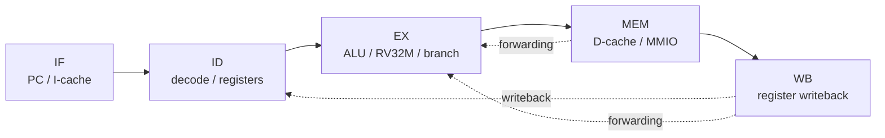
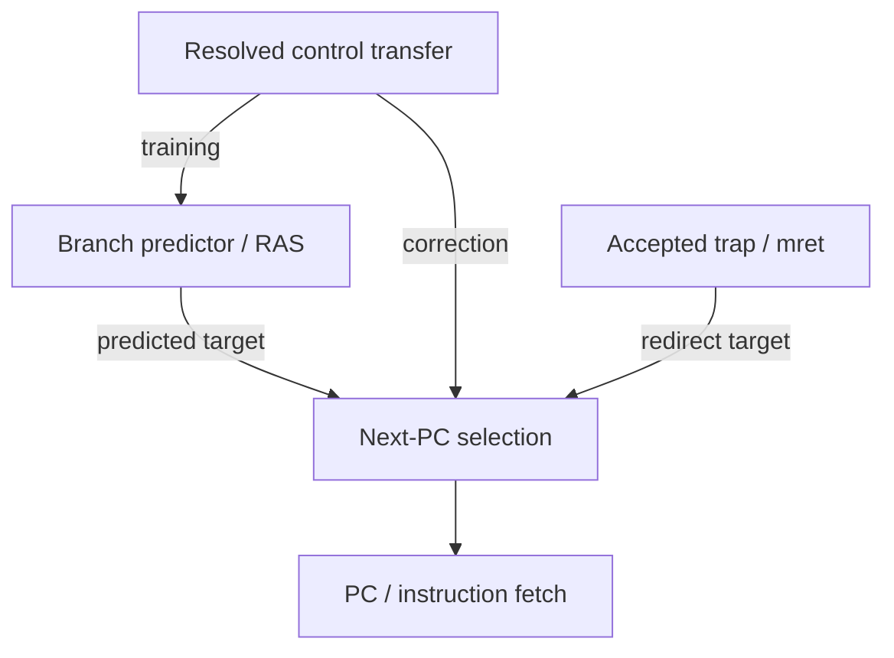
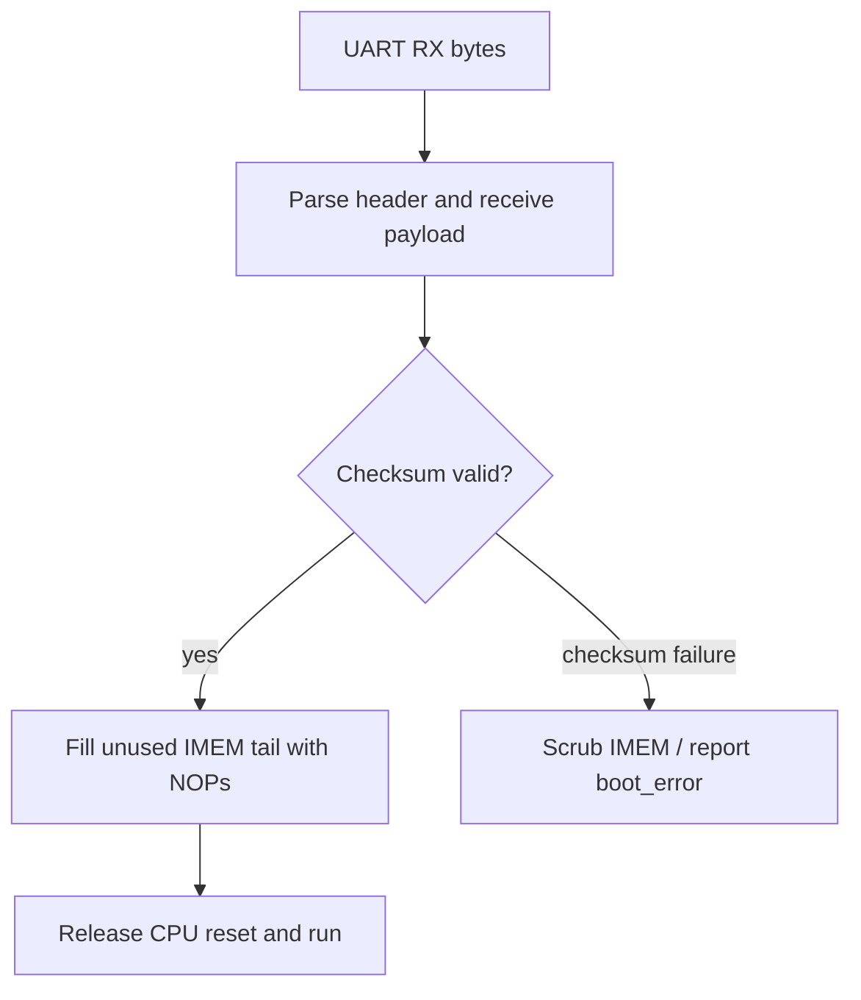

# Architecture

The [README](../README.md) shows the SoC overview. This page expands the
pipeline, memory interface, and UART boot sequence.

## Processor

`RISCVCPU` is an in-order, five-stage RV32IM-style core with fetch, decode,
execute, memory, and writeback state. The implementation includes forwarding,
load-use interlocking, multicycle RV32M execution, branch prediction, a return
address stack, and registered control-redirect handling.

The stage boundaries hold payload and validity separately. Forwarding supplies
available results to EX; load-use interlocks wait for data that is not ready.
Memory backpressure and multicycle RV32M execution can hold earlier stages.
A redirect invalidates younger instructions.

Write eligibility is carried in the pipeline metadata. `IDEXWritesRegister`
excludes x0 before capturing the destination register and write flags in
EX/MEM. EX/MEM forwarding still checks `EXMEMValid` because a bubble can retain
stale flags. MEM/WB captures its write flag with `memwb_input_valid`, so that
registered flag directly enables forwarding and register writeback. This keeps
repeated validity/x0 qualification out of the WB-to-EX operand path.

The ALU shares one variable right shifter across SLL/SRL/SRA and their immediate
forms. Left shifts reverse the input and output bit order; arithmetic right
shifts extend the sign bit. Register shifts use `rhs[4:0]`, while immediate
shifts use `imm_i[4:0]`. The existing instruction decode selects the result,
so this sharing leaves instruction legality and pipeline latency unchanged.

Prediction selects a fetch address. The I-cache then serves that address;
branch resolution and accepted traps can replace the predicted path.

The RV32M unit starts only when the execute-stage operation remains
architecturally accepted. An older memory-stage trap or an accepted redirect
squashes the younger M operation before start, clears core ownership of any
discarded operation, and prevents a later completion from becoming a ready
architectural result. A subsequent M instruction waits for the unit
to become idle and computes its own result.

`FAST_MULTIPLY=0` retains the registered launch plus 32-step iterative
implementation. `FAST_MULTIPLY=1` splits operands into signed 17-bit high/low
limbs and uses four DSP partial products with input, multiplier and output
registers. Carry-save reduction and one carry-propagate addition combine the
terms, returning a multiply result three cycles after acceptance. Division
remains iterative. Scratchpad and DMA can also be
selected independently with `ENABLE_MATVEC_SCRATCHPAD` and
`ENABLE_MATVEC_DMA`, subject to the existing `ENABLE_ACCELERATORS` master
enable. The default enables both and keeps iterative multiplication.
The [architecture study](architecture-evaluation.md) records the measured
trade-offs and the fully pipelined DSP mapping.

Machine-mode CSR logic implements the repository's documented trap subset,
including exceptions, timer interrupts, external interrupts, and `mret`.
The [ISA description](isa_mmio.md) and [operating constraints](limitations.md)
define the supported subset.

Control transfers use 4-byte instruction alignment. A legal taken branch,
`JAL`, or `JALR` with a misaligned target traps before link-register,
predictor, RAS, or wrong-path side effects can commit. Nonzero `JALR funct3`
encodings are illegal instructions. For the rare alignment fault, capture edge
N records the source PC, target, and taken/fallthrough outcome. That registered
state forms `InstructionMisalignPending`; edge N+1 accepts the synchronous
trap, redirects to `mtvec`, and captures CSR metadata into the trap shadow
bank; edge N+2 commits architectural
`mepc`/`mcause`/`mtval`. A newly pending interrupt cannot enter while the
control transfer is unresolved, so the alignment fault is captured first. If
`ControlInterruptDeferred` was already set by an earlier resolved control
instruction, that interrupt belongs to the preceding precise boundary: it is
accepted before the current ID/EX instruction executes, and `mepc` records that
instruction for replay after `mret`. Ordinary aligned control transfers retain
their existing latency.

`exception_decode_unit` owns instruction legality and exception
classification. `RISCVCPU` owns cause mapping and acceptance priority so those
timing-factored control cones remain separate; it also owns the registered
instruction-misalignment handoff, interrupt deferral, redirect timing, and CSR
side-effect sequencing.

Execute-stage architectural effects use a shared acceptance boundary. When an
older data-memory operation applies D-cache backpressure, ID/EX validity and
payload remain held, but synchronous exception entry and CSR writes remain
inactive. After the memory transaction completes, the held instruction is
accepted once: a CSR operation captures its pre-write readback value, or an
exception enters the trap pipeline once. A pending instruction-alignment fault
is likewise retained until that boundary.

Frontend recovery uses `exception_pending` to select the redirect and its
target before D-cache backpressure arrives. `exception_taken` still marks
accepted trap entry. The pipeline applies the memory-stall guard to PC and
stage updates; the pending request alone cannot update CSR state. Target
selection preserves exception, mret, interrupt, then control-recovery priority.

When EX advances a bubble, EX/MEM payload bits are don't-care and may capture
new values. `EXMEMValid` is the sole bubble authority; write metadata and
payload are interpreted only while it is set. A real D-cache hold still
preserves the live transaction.
IF/ID uses the same validity contract: redirect cycles may capture don't-care
fetch payload, while `IFIDValid=0` prevents that payload from entering execute.

### Reading the RTL control paths

The pipeline registers in [the core](../rtl/core/riscv_cpu_core.v) are grouped
by stage: `IFID*`, `IDEX*`, `EXMEM*`, and `MEMWB*`. Within each group, payload
and the `Valid` bit describe the same instruction. `OP_LOAD`, `OP_STORE`, and
`OP_BRANCH` identify opcode classes; `funct3` and `funct7` select individual
operations.

| Control | Meaning | Where to follow it |
| --- | --- | --- |
| `if_hold`, `id_bubble`, `ex_advance` | Hold a transaction, inject a bubble, or advance a stage | [pipeline_control_unit](../rtl/core/pipeline/pipeline_control_unit.v) and the core's sequential stage updates |
| `interrupt_eligible`, `interrupt_taken`, `redirect_taken` | Separate a pending interrupt from accepted entry and a frontend redirect request | [trap_redirect_control_unit](../rtl/core/csr/trap_redirect_control_unit.v) |
| `EXMEMLoadValid`, `EXMEMStoreValid` | A valid MEM-stage load or store; the destination block supplies its own address and handshake conditions | Core memory decode and MMIO endpoint connections |
| `memwb_input_valid`, `memwb_update`, `retire_event` | Qualify the MEM/WB input, capture it, and report a retired event after cache-miss gating | Core pipeline-control and retirement section |

## Key implementation parameters

| Block | Configuration |
| --- | --- |
| I-cache | Default 64 bytes; configurable 64..4096 bytes, 16-byte lines, 2-way set associative |
| D-cache | 64-byte default or 128-byte primary, 16-byte lines, direct-mapped; optional 1/2/4/8 victim lines |
| Branch predictor | 16-entry BHT and 16-entry BTB |
| Return address stack | 8 entries |
| RV32M unit | Default: registered launch + 32 iterative steps; optional fast multiply: 3 cycles after acceptance; division unchanged |
| MATVEC Scratchpad | One signed-int8 vector, 1 to 16 rows |
| MATVEC DMA-lite | DMEM-backed vector/matrix/result descriptors, 1 to 4 rows |

## Memory system

The default core has separate instruction and data caches with 128-bit refill
lines. Internal simulation memories and the external DMEM BRAM share the same
CPU-facing request/ready contract. Loads and stores use one
byte/halfword/word formatting unit, including MMIO subword aliases.

`ICACHE_BYTES` sets instruction-cache capacity in powers of two from 64 to
4096 bytes. With two ways and 16-byte lines, the number of sets is
`ICACHE_BYTES / 32`. `ICACHE_PARALLEL_LOOKUP=1` preserves the original 64-byte
implementation, which compares its four physical tags before selecting the
set. Set it to `0` for indexed lookup and larger capacities. The core and
the Basys3 boot/runtime wrapper expose these parameters; unsupported enabled
I-cache combinations assert `config_error`. Changing cache capacity does not
change backing-memory capacity, the line interface, or the ISA.

The indexed version splits each way into one tag bank and four instruction
banks, each with one refill write port and an asynchronous set-indexed read.
Valid bits are reset; payload RAM is not. Return hints share the instruction
banks. The [I-cache study](icache-study.md) connects this memory mapping to
same-binary execution cycles and whole-SoC FPGA cost.

UART-loaded instruction memory interleaves words across four banks: bank `b`
holds word `4*k+b` at row `k`. A 128-bit line read takes one word from each
bank at the same row. UART payload and cleanup writes update just one bank.
Each bank therefore needs one read port instead of replicating the entire
memory for four reads. Reads remain combinational, including NOP padding for
partial or out-of-range lines; loading and CPU-release timing are unchanged.

The external IMEM and DMEM ports are cache-line request/ready protocols, so an
external instruction-memory configuration requires the I-cache and an external
data-memory configuration requires the D-cache. Unsupported cache-disabled
external combinations assert the core's `config_error` output instead of
silently appearing valid. External DMEM capacity must be at least one complete
4-word line and a multiple of four words; the external BRAM block exposes the
same configuration error. The external DMEM block acknowledges out-of-range
line requests with zero data and ignores out-of-range writes.
Its `SIM_INIT_HEX` parameter initializes simulation only; synthesized Basys3
DMEM is populated through accepted runtime writes, including UART-loaded
firmware activity.

The central MMIO decoder accepts only implemented word offsets. An access
bypasses the D-cache only when the exact decoder select is active. Unmapped
addresses, including every address in pages `0x0400` and `0x0500`, follow the
ordinary memory path.

The D-cache read-data mux selects refill data in `CACHE_REFILL` and the
indexed cache word otherwise. This selection depends on registered state,
while `load_word_valid` separately checks hit/read qualification or accepted
refill completion. The CPU captures the word only when valid, keeping tag,
MMIO, and access-fault checks out of the payload-selection path.

Instruction and ordinary data addresses are checked against the configured
word capacity before architectural acceptance. Out-of-range instruction,
load, and store accesses raise causes 1, 5, and 7 with the byte address in
`mtval`. Internal memories and external BRAM wrappers also return NOP/zero and
ignore out-of-range writes, so disabled-trap profiles do not turn
truncated high address bits into low-memory aliases.
An out-of-range data access suppresses the D-cache request and therefore cannot
produce a cache miss. Precise fault acceptance checks only already-active
cache, DMA-ownership, or UART holds instead of feeding the combinational miss
result back into the trap path.

## UART boot

The CPU remains held throughout reception, validation, and cleanup. Invalid
headers or lengths are rejected before normal payload completion.

Packet boot writes payload words while receiving them, but it does not release
the CPU until checksum validation and image cleanup complete. A checksum
failure scrubs the instruction memory before reporting `boot_error`; a
successful packet replaces its declared payload and clears every unused tail
word to NOP. Reset can abort an incomplete packet, and the next successful
packet restores a clean image before release. The loader rejects zero-length
images. A 32-bit additive checksum detects transfer errors; packets are not
authenticated.

## SoC integration

The active peripheral groups are GPIO, UART, performance counters, MATVEC
Scratchpad, machine timer, and MATVEC DMA-lite. `mmio_decode` owns write/bypass
selection and `mmio_read_mux` owns readback selection.

UART TX backpressure participates in the memory-stage pipeline hold. A one-byte
output slot holds valid/data until the transmitter accepts them; another store
waits while that slot is occupied, including the acceptance edge. UART status
bit 1 reports whether this path can accept a new store. The physical RX pin passes
through a two-flop synchronizer before 8N1 sampling, with at least three clocks
per bit. Runtime RX uses a 64-byte FIFO. RXDATA reads consume the oldest byte;
RX-valid means the FIFO is nonempty. When full, an incoming byte is dropped
unless a CPU read frees a slot on the same clock edge. The sticky overrun flag
is visible in UART status bit 2 and clears on reset.
Basys3 switch inputs pass through independent two-flop synchronizers before
entering the GPIO path; simultaneous multi-switch changes are not an atomic
sample.
The runtime SoC board reset likewise uses an `ASYNC_REG`-marked two-flop
synchronizer with synchronous assertion and release. Power-up values hold the
SoC in reset until two sampled clock edges have propagated.

MATVEC Scratchpad completion drives the existing machine external-interrupt
pending input. DMA-lite exposes no interrupt source and must be polled.

While DMA-lite is busy, CPU non-MMIO data-memory operations stall. DMA reads
use the resident D-cache word on a snoop hit, and accepted DMA writes update
that cached word when present. See the [software sequence](accelerators.md#software-sequence-and-cache-behavior)
for the ownership contract. Descriptor
validation rejects matrix/output overlap so a completed result cannot overwrite
a matrix row that the engine has not read yet.

`mtime` and `mtimecmp` expose independent 32-bit read/write halves. Software
uses the retry/write sequences documented in
[ISA and MMIO](isa_mmio.md).

## Configurable slices

Top-level parameters can disable RV32M, accelerators, timer, caches, branch
prediction, performance counters, control redirects, or CSR/trap logic for
targeted tests and alternate bring-up profiles. Defaults preserve the
default-feature SoC configuration. Cache-disable parameters are supported with
the internal memories; they do not convert the external cache-line ports into
single-word bypass interfaces.
