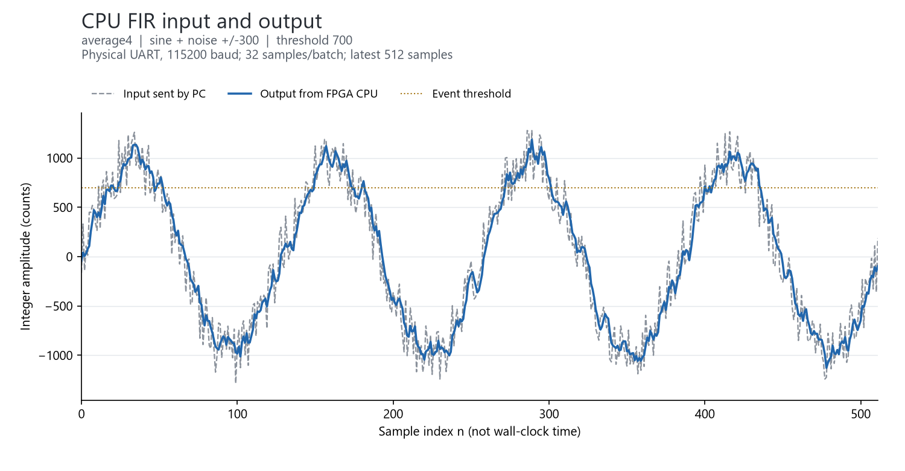

# Physical signal viewer capture

The Basys3 CPU returned all 8,704 expected FIR outputs in ten sessions, with
matching threshold events and sample counters and no UART overrun. This run
used the checked FIR2 firmware and the `fast_cpu` application image at 100 MHz.
It was recorded on 2026-10-01 in New York (2026-10-02 UTC).



The chart contains 512 physical outputs, not a locally substituted filter.
Input is a 1,000-count sine with period 128 samples plus uniform integer noise
from -300 to 300, seed 1. The CPU uses coefficients `[1, 1, 1, 1]`, scale 2 and
threshold 700. It divides the sum by four with truncation toward zero and starts
with zero history. Input and output share the sample-index and amplitude axes;
the FIR delay is preserved. UART is host-paced at 115200 baud, not a fixed-rate
sensor sampling clock.

## Checks performed

| Session group | Sessions | Outputs checked |
| --- | ---: | ---: |
| Exported four-tap sine capture | 1 | 512 |
| Bypass, four/eight-tap average and difference, each on sine and step | 8 | 4,096 |
| Sustained eight-tap sine, 128 batches | 1 | 4,096 |
| Total | 10 | 8,704 |

The tracked checker compares the actual viewer transport against a separate
FIR calculation, including cross-batch history and threshold counts. The
4,096-sample run also checks that the viewer retains only its latest 512 points.
The exported CSV was independently reread and all 512 outputs recalculated.
Recorded round-trip times include host scheduling; they are not a controlled
before/after performance experiment. The earlier
[UART burst comparison](../signal_console_burst_2026-10-01/README.md) remains the
performance comparison and includes the operator-confirmed reset test.

## Identity and files

The viewer check ran from source commit `1f4d6ecccb6017fcb562278b9fe4eb1d3ef8c6fe`.
Each result records its actual input hashes. The implementation was launched
from `25cbc07` with pending build-script changes, so its summary retains that
commit and dirty flag; its recorded RTL and constraint hashes match the sources
used for this capture. No RTL or C firmware behavior changed in this workflow
integration.

| File | Purpose |
| --- | --- |
| [viewer-validation.json](viewer-validation.json) | Numerical checks, all ten sessions, firmware and source hashes |
| [viewer-checked.csv](viewer-checked.csv) | Sample index, input and CPU output for the figure |
| [viewer-checked.json](viewer-checked.json) | Capture settings, counters and CSV/PNG hashes; `captured` is not a correctness verdict |
| [start-programming.json](start-programming.json) | Actual JTAG programming result and bitstream/build-summary hashes |
| [start-programming.log](start-programming.log) | Unmodified XSDB command and output |
| [signal-console-summary.json](signal-console-summary.json) | Routed implementation, source identity and bitstream hash |

The image uses 6,733 LUT, 5,287 FF, 2 BRAM and 4 DSP. At a 10 ns clock period,
setup WNS is +0.149 ns and hold WHS is +0.017 ns; timing and DRC passed.
The programmed bitstream SHA-256 is
`d5f5c775ee4ce2b6efb6bc87b9fb6171026ebe4c2b0b4a2f9f94bd64584a90d0`.
The uploaded firmware packet SHA-256 is
`d370180c6402cce6d9d791a88e562a7ad50831b1a7a92aed80e4e8da670e8c96`.

XSDB emitted a permission-denied message while deleting a temporary `tcf` file.
The original log preserves it. Programming returned exit code 0, XSDB confirmed
the FPGA was configured, and subsequent firmware communication and all output
checks passed. The operation changed volatile FPGA configuration, not Flash.

## Reproduce

Follow [application setup](../../../signal-console.md#build-and-test), then
close other serial clients. With the matching application image loaded, press
BTN C and run from the repository root, replacing COM3 with the board's port:

```powershell
.venv/Scripts/python.exe -B scripts/signal_console_check.py
.venv/Scripts/python.exe -B scripts/signal_console_check.py --port COM3 --viewer
powershell -ExecutionPolicy Bypass -File scripts/results-overview.ps1
```

The second command uploads the checked firmware before exercising the viewer.
It writes current results under `results/signal-console/`; repeated runs replace
those files and do not modify this dated capture. After power loss, first load
the application image using the explicit
[startup programming command](../../../signal-console.md#startup-and-recovery).
The archived files above are byte-for-byte copies of this run's outputs.
